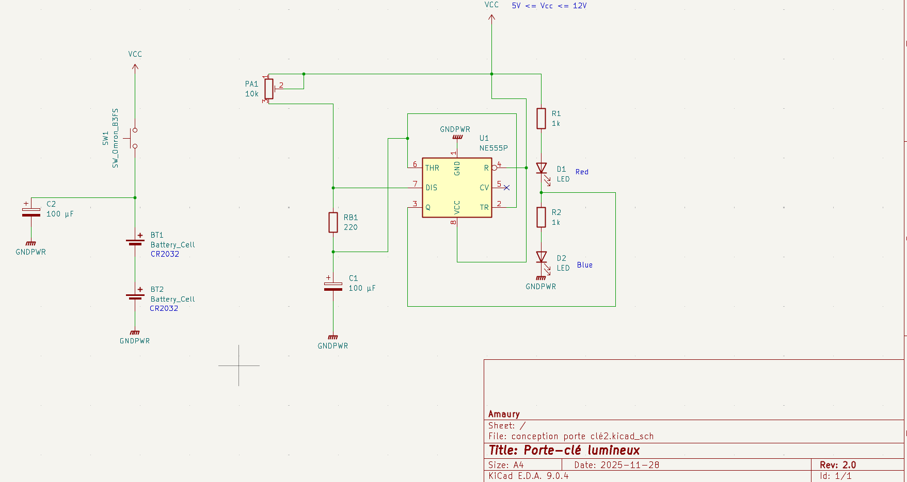
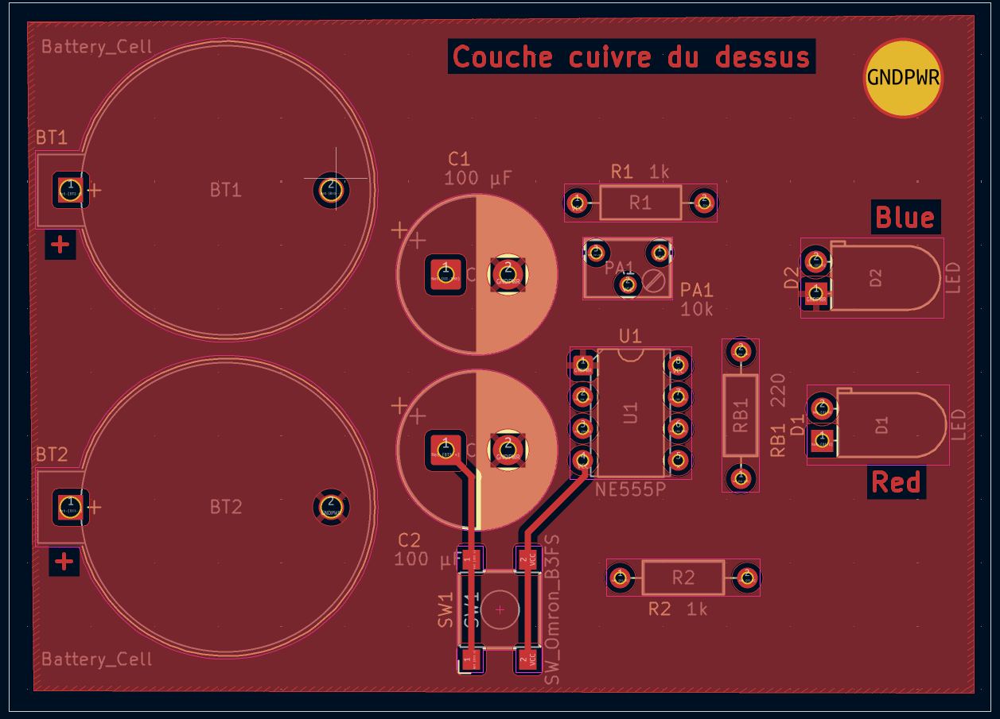
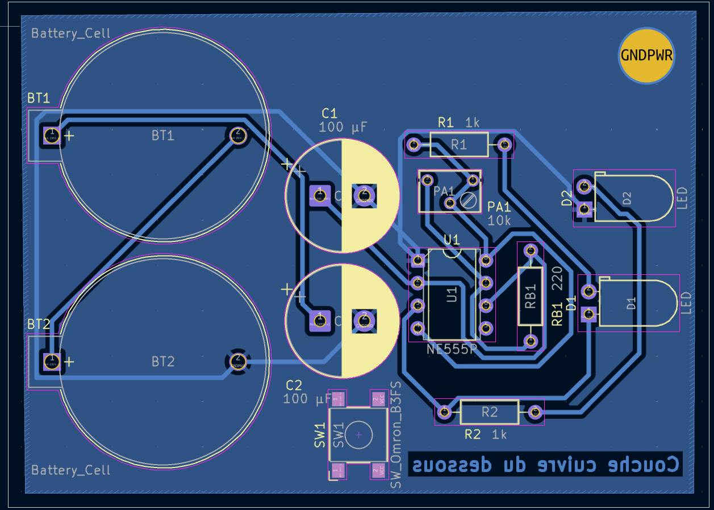

# Porte-clés clignotant 

## Contexte du projet 

Premier circuit imprimé réalisé à l'aide de Kicad consistant à faire clignoter deux LEDs (verte et bleue).
On peut régler la fréquence du clignotement à l'aide du potentiomètre.

## Fonctionnement
Le circuit est composé d'un NE555 qui permet de faire clignoter alternativement les deux LEDs. La fréquence du cycle de clignotement est réglable via un potentiomètre.  
Le porte-clés est alimenté par deux piles boutons CR2032.

## Vidéos de démonstration du porte-clés réalisé

https://github.com/user-attachments/assets/a9404657-2942-4910-9b81-8aab252a95bd

https://github.com/user-attachments/assets/f14d513b-74e3-48db-ba6a-31ed8998a323

## Schématique \& PCB 

